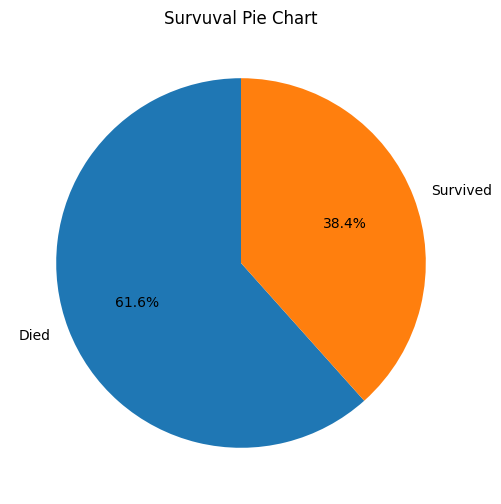
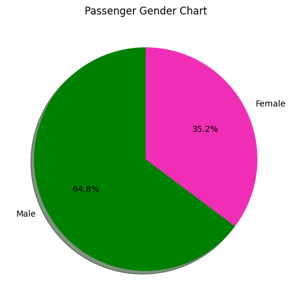
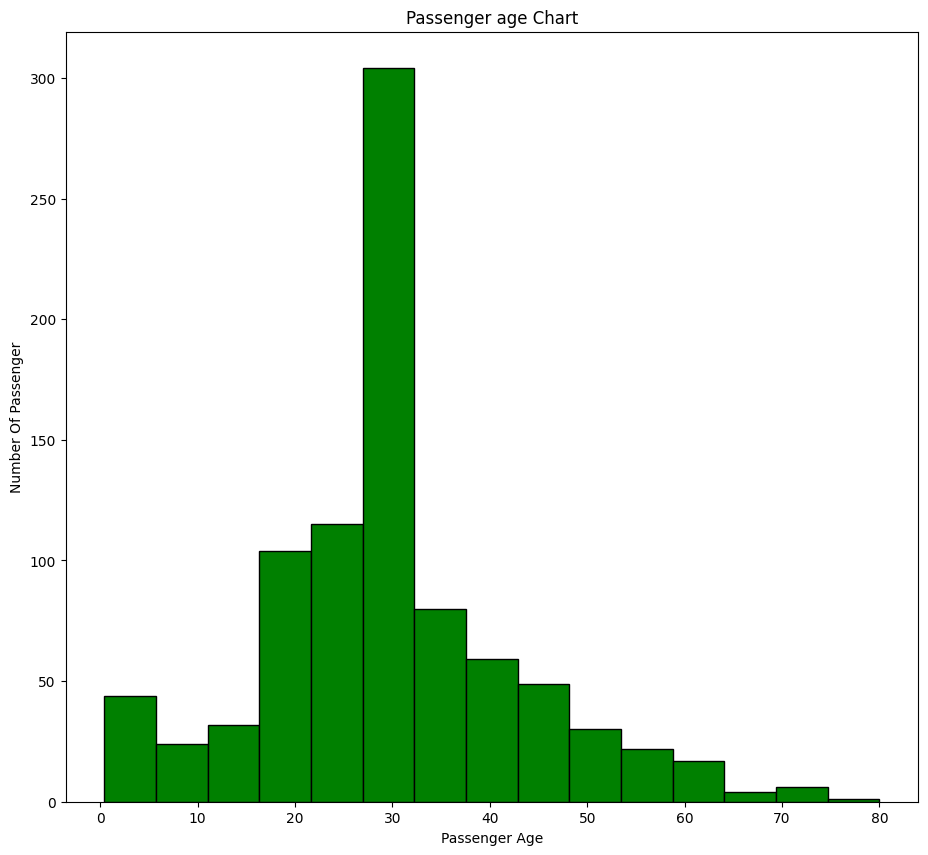
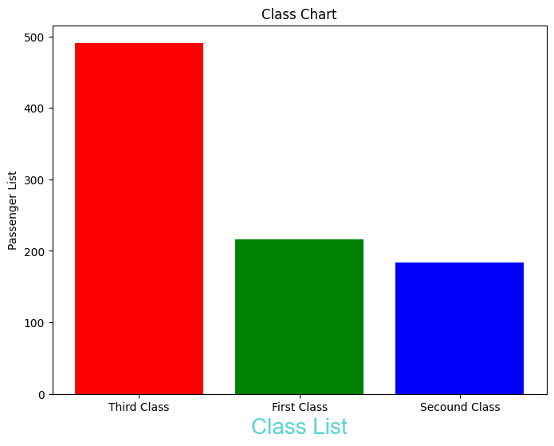
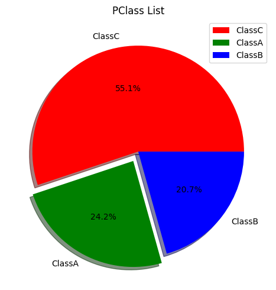
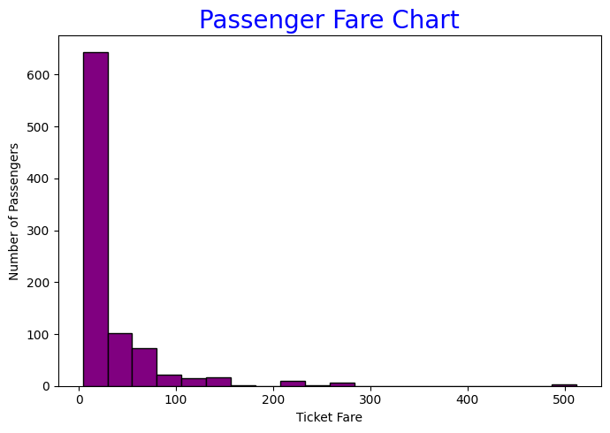
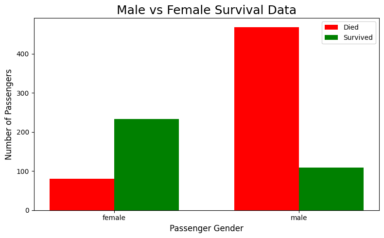
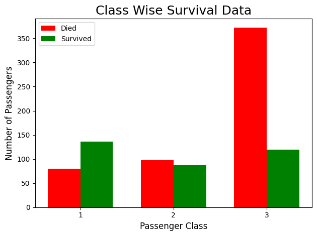
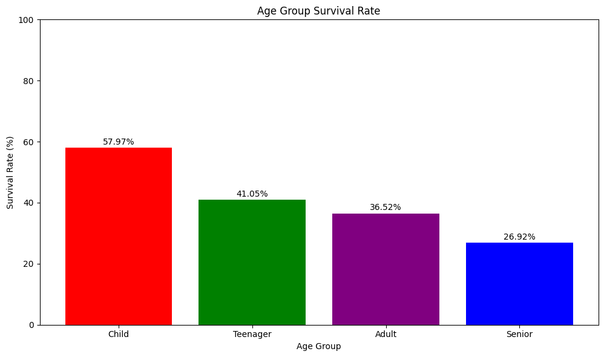

# Titanic Dataset: Data Cleaning & Exploratory Analysis

A beginner-friendly data analysis project on the famous Titanic passenger dataset. The raw data is cleaned in a Jupyter notebook, and the cleaned data is explored with charts to understand who survived the disaster and why.

## Project Structure

```
Titanic Data/
├── Titanic-Dataset.csv          # Raw dataset (input)
├── Titanic_Dataset_clean.ipynb  # Cleaning + visualization notebook
├── Clean_Titanic_Data.csv       # Cleaned dataset (output)
└── Graph/                       # Exported charts
    ├── Survival_pie_Chart.png
    ├── Passenger_Gender_Chart.png
    ├── Passenger_Age_chart.png
    ├── Class_Chart.png
    ├── PClass_List.png
    ├── Passenger_Fare_Chart.png
    ├── Male_vs_Female_servival_data.png
    ├── Class_wise_Survival_Data.png
    └── Age_Group_Survival_Rate.png
```

## Dataset

891 passengers, 12 columns in the raw data (13 after cleaning, with the new `Age_Group` column).

| Column | Description |
|---|---|
| `PassengerId` | Unique passenger ID |
| `Survived` | 0 = Died, 1 = Survived |
| `Pclass` | Ticket class (1 = First, 2 = Second, 3 = Third) |
| `Name` | Passenger name |
| `Sex` | male / female |
| `Age` | Age in years |
| `SibSp` | Number of siblings / spouses aboard |
| `Parch` | Number of parents / children aboard |
| `Ticket` | Ticket number |
| `Fare` | Ticket fare |
| `Cabin` | Cabin number |
| `Embarked` | Port of embarkation (C = Cherbourg, Q = Queenstown, S = Southampton) |
| `Age_Group` | *(new)* Child, Teenager, Adult, Senior |

## 1. Data Cleaning

Missing or invalid values in the raw data:

| Column | Problem | How it was handled |
|---|---|---|
| `Age` | 177 missing | Filled with the **median** (28.0). Z-score was checked for outliers. |
| `Cabin` | 687 missing | Filled with `Unknown_Cabin` (too many missing to drop or guess). |
| `Embarked` | 2 missing | Filled with the **mode** (`S`). |
| `Fare` | 15 zero values | Zeros treated as missing and replaced with the **median fare of the passenger's class**. |

Other steps:
- Whitespace stripped from `Name`.
- Fare outliers checked with Z-score (|z| > 3) and reviewed by class and name.
- New `Age_Group` feature created with these bins:

| Age_Group | Age range |
|---|---|
| Child | 0 to 12 |
| Teenager | 13 to 19 |
| Adult | 20 to 59 |
| Senior | 60+ |

The cleaned data has **no missing values** and is saved as `Clean_Titanic_Data.csv`.

## 2. Exploratory Data Analysis

Charts made with Matplotlib:

- Overall survival (bar chart and pie chart)
- Passenger gender distribution
- Passenger age distribution (histogram)
- Passenger class distribution (bar and pie)
- Ticket fare distribution (histogram)
- Male vs female survival
- Class-wise survival
- Survival rate by age group

### Key Findings

| Factor | Survival rate |
|---|---|
| **Overall** | 38.4% |
| Female | 74.2% |
| Male | 18.9% |
| First class | 63.0% |
| Second class | 47.3% |
| Third class | 24.2% |
| Child (0-12) | 58.0% |
| Teenager (13-19) | 41.1% |
| Adult (20-59) | 36.5% |
| Senior (60+) | 26.9% |

- Women were nearly **4 times** more likely to survive than men.
- Higher ticket class meant a much better chance of survival.
- Children had the highest survival rate among age groups.
- Most passengers were male (577 vs 314) and travelled in third class (491 of 891).

## Graph Gallery

| | |
|---|---|
|  |  |
|  |  |
|  |  |
|  |  |
|  | |

## Tech Stack

- Python 3
- Pandas, NumPy
- Matplotlib
- Jupyter Notebook

## How to Run

1. Clone or download this project.
2. Install the requirements:
   ```bash
   pip install pandas numpy matplotlib jupyter
   ```
3. Start Jupyter and open the notebook:
   ```bash
   jupyter notebook Titanic_Dataset_clean.ipynb
   ```
4. Run all cells. It reads `Titanic-Dataset.csv`, saves `Clean_Titanic_Data.csv`, and draws all charts.

> Keep the notebook and CSV files in the same folder so the relative file paths work.

## Author

*Your name here*
